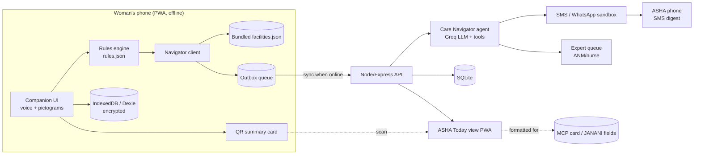

# IMPLEMENTATION_PLAN.md — Vatsala

Companion docs: `idea.md` (what & why), `context.md` (research, rules, constraints).
Team size assumed: 4 (adjust roles if 2–3).

---

## 0. Guiding principles (read before writing any code)

1. **Safety path = deterministic + offline.** Rules engine decides GREEN/AMBER/RED. The LLM explains, routes and writes messages; it can never lower a level.
2. **Remove work from the ASHA.** No forms on her side. Ever.
3. **Offline first, then sync.** Every action works in airplane mode; network only moves data.
4. **Voice for everything critical.** Pre-recorded audio for RED/AMBER messages in each language.
5. **Privacy by default.** Data on device, encrypted, shared per category with consent. No analytics SDKs.
6. **Every rule has a source.** No source, no rule.
7. **Fresh code at the finale.** Prepare *assets*, not code, before 18 Dec (see context.md §7).

---

## 1. Architecture



**Key idea:** the phone can produce a RED result, show the right facility and queue the ASHA alert with *zero* connectivity. The server only adds the agent's richer message, SMS delivery, follow-ups and the ASHA dashboard.

---

## 2. Repo structure (fresh repo at the finale)

```
vatsala/            # new repo, separate from the prior eunoia v2 repo
├── apps/
│   ├── companion/            # Woman-facing PWA (React + Vite)
│   │   ├── src/
│   │   │   ├── stages/       # cycle/ pregnancy/ postpartum/ baby/
│   │   │   ├── checkin/      # pictogram symptom picker + voice
│   │   │   ├── triage/       # result screens GREEN/AMBER/RED
│   │   │   ├── navigator/    # facility finder, call 108, ASHA notify
│   │   │   ├── learn/        # audio lessons, myth-buster
│   │   │   ├── privacy/      # PIN, discreet mode, sharing toggles
│   │   │   ├── db/           # Dexie schema + outbox
│   │   │   └── i18n/         # en, hi, ta
│   │   └── public/audio/     # pre-recorded safety clips per language
│   └── asha/                 # ASHA Today view PWA (can be same app, role switch)
├── packages/
│   ├── rules/                # rules.json + engine.js + tests (shared)
│   └── schedules/            # anc.json, pnc_hbnc.json, uip_vaccines.json
├── server/
│   ├── routes/               # sync, triage-events, asha, expert, sms
│   ├── agent/                # tools + prompts + guardrails
│   ├── db/                   # SQLite schema + seed
│   └── data/facilities.json  # demo district
└── docs/                     # idea.md, context.md, this file, demo-script.md
```

---

## 3. Data model

### On device (Dexie)
| Table | Key fields |
|---|---|
| `profile` | id, name/alias, lang, dob, stage (`cycle`/`preconception`/`pregnancy`/`postpartum`), lmp, edd, delivery_date, village, asha_id, pin_hash, discreet_mode, share_prefs{pregnancy, cycle, mental} |
| `cycles` | start_date, end_date, flow_level, pain_level, notes |
| `checkins` | ts, stage, week_or_day, symptoms[], vitals{bp?, temp?, hb?} |
| `triage_events` | id, ts, level, rule_ids[], facility_id, acted (bool), synced (bool) |
| `reminders` | type (anc/ifa/td/pmsma/vaccine/pnc), due_date, done |
| `outbox` | id, type, payload, created_at, attempts |

### Server (SQLite)
`women` (id, alias, asha_id, stage, edd, share_prefs), `ashas` (id, name, phone, lang, village_ids), `events` (triage events synced), `actions` (asha_id, woman_id, event_id, action, ts), `followups` (event_id, due_at, status), `expert_questions` (id, woman_id, text, lang, answer, status), `facilities` (id, name, type, level, lat, lng, services[], phone, hours).

Encrypt on-device data with a key derived from the PIN (Web Crypto AES-GCM). If no PIN is set, still store under a device key and warn the user.

---

## 4. The rules engine

### 4.1 Rule schema
```json
{
  "id": "PREG_HEADACHE_VISION",
  "stage": ["pregnancy"],
  "when": { "all": ["severe_headache", "blurred_vision"], "gest_week_gte": 20 },
  "level": "RED",
  "message_key": "red.preeclampsia_signs",
  "audio": "red_preeclampsia",
  "facility_need": ["FRU", "CHC"],
  "source": "MCP card – danger signs in pregnancy (VERIFY page/edition)",
  "reviewed_by": null
}
```
`when` supports `all`, `any`, numeric comparisons (`bp_sys_gte`, `temp_gte`, `gest_week_gte`, `pp_day_lte`, `bleed_days_gt`, `cycle_len_lt/gt`), and `count_in_last_n_cycles`.

### 4.2 Engine (≈40 lines, pure JS, shared by phone + server)
```js
export function triage(ctx, rules) {
  const fired = rules.filter(r => r.stage.includes(ctx.stage) && match(r.when, ctx));
  const rank = { RED: 3, AMBER: 2, GREEN: 1 };
  const level = fired.reduce((m, r) => rank[r.level] > rank[m] ? r.level : m, "GREEN");
  return { level, fired: fired.filter(r => r.level === level), all: fired };
}
```
Output always includes `fired[].id` and `source` so the UI can show "why".

### 4.3 Draft rule set (DRAFT — clinician must review; verify each against MCP card/guidelines)

**Pregnancy, RED (go now / call 108):** any vaginal bleeding; severe headache or blurred vision (≥20 wks); fits/convulsions or unconsciousness; severe abdominal pain; leaking fluid before labour; reduced or absent fetal movement (≥28 wks); high fever; breathlessness at rest; swelling of face/hands with headache; BP ≥160/110 if measured.
**Pregnancy, AMBER (see ASHA/ANM 24–48 h):** BP ≥140/90 if measured; Hb <11 if known (severe <7 is RED); persistent vomiting; burning urine; swelling of feet alone; missed ANC visit; IFA not taken >7 days.
**Postpartum (day 0–42), RED:** heavy bleeding (soaking a pad within an hour) or large clots; fever; foul-smelling discharge; fits; severe headache/vision; breathlessness or chest pain; painful swollen calf; thoughts of harming self or baby.
**Postpartum, AMBER:** painful red breast; wound redness/discharge (incl. C-section); persistent low mood >2 weeks; urine/stool incontinence.
**Newborn (stretch):** not feeding, convulsions, fast breathing, very cold/hot, yellow palms/soles, umbilicus red/pus → RED.
**Cycle / adolescent, AMBER:** bleeding >7 days; soaking pad every hour (heavy); cycles repeatedly <21 or >35 days (3+ cycles); no period by age 15; bleeding between periods; pain stopping school/work despite simple measures; missed period + sexually active → "take a pregnancy test / see ASHA". RED: very heavy bleeding with dizziness or fainting.
**Mental health (any stage):** self-harm language → crisis support screen + helplines; ASHA alert only with consent unless imminent risk.

Target for the demo: **25–40 rules**, each with a test case.

### 4.4 Tests
`packages/rules/tests/*.test.js`: one positive and one negative case per rule, plus "worst wins" tests. Run in CI or manually before the demo. This is your answer when a judge asks "how do you know it's safe?"

---

## 5. Care Navigator agent

### Trigger
Any AMBER/RED event (on sync) or a free-text/voice question.

### Tools (JSON schema for LLM tool-calling)
| Tool | Input | Output | Notes |
|---|---|---|---|
| `find_facility` | lat, lng, need[] (FRU/CHC/PHC/SC), stage | top 3 facilities with distance, phone, hours | Same logic runs offline on phone |
| `notify_asha` | woman_id, level, rule_ids, facility_id, summary | message_id | Template-based; LLM may only fill the summary field (≤160 chars) |
| `schedule_followup` | event_id, hours | followup_id | RED default 4 h; AMBER 24 h |
| `explain` | rule_id, lang, reading_level | short text | Grounded on the rule's `message_key` + curated docs |
| `check_schemes` | stage, parity, facility_type | list of entitlements + where to ask | Static JSON; verify amounts before showing any |
| `ask_expert` | question, lang | ticket_id | Human ANM/nurse answers; agent relays |

### Guardrails (enforced in code, not just prompt)
- Agent receives the triage level as **read-only**; any tool call with a lower level is rejected.
- Denylist: dosing, prescriptions, diagnosis words ("you have pre-eclampsia") → rewrite to "these can be signs of a serious problem".
- Max 3 tool calls per event; all calls logged in `actions`.
- If the LLM API fails → fall back to template messages (the demo must survive the Wi-Fi dying).

### Grounding docs (curated, ~10–20)
MCP card text, MoHFW ANC/PNC patient material, HBNC guide, UIP schedule, menstrual hygiene IEC material, Eunoia's own reviewed articles. Simple retrieval (MiniSearch/BM25) is enough; no vector DB needed for 24 h.

---

## 6. ASHA Today view

**Ranking:** `RED unresolved (oldest first)` → `follow-up due` → `missed ANC/vaccine` → `PNC/HBNC visit day due` → `new registration`.
**Row:** name/alias, stage + week/day, reason (plain words), distance, buttons [Visited] [Called] [Referred] [Couldn't reach], 🎤 optional.
**Digest:** 7 a.m. SMS, max 5 lines, e.g. `Today: 1 urgent (Sunita 34w headache+vision → CHC X). 2 visits due: Meena PNC day 7, Rani ANC-3. Reply 1 to hear.`
**QR scan:** reads the woman's summary QR (signed JSON: alias, stage, EDD, last 3 events, open flags) and links her to this ASHA.
**HBNC schedule:** home visits on days 3, 7, 14, 21, 28, 42 after institutional delivery. Verify this against the current HBNC guideline before encoding it.

---

## 7. API (server)

| Method | Path | Purpose |
|---|---|---|
| POST | `/sync` | Upload outbox items; returns acks + any expert answers |
| POST | `/events` | Triage event (also via sync) → triggers agent |
| GET | `/asha/:id/today` | Ranked list |
| POST | `/asha/:id/action` | Visited/called/referred/unreachable |
| POST | `/expert` · GET `/expert/queue` · POST `/expert/:id/answer` | Expert-in-the-loop |
| POST | `/sms/inbound` | ASHA replies "1" → voice/expanded detail |
| GET | `/facilities?lat&lng&need` | Online facility lookup |

Auth: phone + OTP is ideal but mock it in the demo (seeded users). Don't spend finale hours on auth.

---

## 8. Timeline

### Phase A — Now → 27 Nov: Round 1 (idea + validation, no app code)
| Task | Owner | Done when |
|---|---|---|
| Email organisers about Eunoia disclosure + asset prep | Lead | Written reply saved |
| Fix Eunoia README merge conflict; add "prior work" note | Dev 1 | README clean |
| Talk to 2–3 real people: an ASHA/ANM (phone call via any contact), a gynaecologist or community medicine faculty, 2 young women | All | Notes in `docs/interviews.md` with 3 quotes |
| Draft `rules.json` v0 (25 rules) with sources | Lead + Dev 3 | Each rule sourced |
| Fill the official Round 1 template (see idea.md §11) | Designer | Submitted before 26 Nov (1-day buffer) |
| One architecture diagram + 3 key screens (Figma) | Designer | Exported PNGs in deck |

### Phase B — 28 Nov → 10 Dec: Prepare assets (still no app code)
- Clinician review of `rules.json` → record reviewer name in `reviewed_by`.
- Translations EN/HI/TA for all UI strings + rule messages; native-speaker check.
- Record audio clips: ~30 messages × 3 languages (phone voice memo, quiet room, consistent voice).
- Build `facilities.json` for the demo district: name, type, level, lat/lng, phone, 24×7 delivery yes/no. Mark the source.
- Schedules JSON: ANC, PMSMA, PNC/HBNC, UIP vaccines, verified.
- Seed data: 3 women (Priya, Sunita, Meena), 1 ASHA (Lakshmi), 1 ANM.
- Get the SMS route working on a throwaway test (Twilio sandbox or gateway) to know the gotchas. Delete the test code afterwards.
- Dec 5–9: **confirm participation within 2 days of results.** Book travel immediately.

### Phase C — ~11 Dec → 17 Dec: Map to official problem statements
When the problem statements drop, pick the closest one and adapt using this table:

| If the PS is about… | Lead with | Keep | Cut |
|---|---|---|---|
| Women's health / maternal care | Full concept | Everything | — |
| Women's safety / empowerment broadly | Discreet mode + closed-loop help + schemes | Rules engine, navigator, ASHA loop | Baby module |
| Agentic AI for social good | Care Navigator agent + tools + guardrails | Rules engine as the "safety layer" | Learn module |
| Health tech for rural / offline | Offline triage + facility finder + sync | ASHA view | Gamification |
| Adolescent health / menstrual hygiene | Cycle mode + myth-buster + discreet mode | Rules for cycle red flags, ASHA/teacher link | Postpartum, baby |
| Disaster management (stretch fit) | Pregnant/postpartum women registry + nearest functioning facility + offline alerts during outages | Offline + sync + navigator | Learn |

Then: write `docs/finale-scope.md` (must-have list, see §9), rehearse the demo story on paper, and assign hour blocks.

### Phase D — 18–19 Dec: 24-hour build (hour-by-hour)

Roles: **Lead/Agent (A)**, **Frontend Companion (B)**, **Frontend ASHA + PWA/offline (C)**, **Backend/Data + Pitch (D)**.

| Hours | A: Lead / Agent | B: Companion UI | C: ASHA view / Offline | D: Backend / Pitch |
|---|---|---|---|---|
| 0–1 | Repo, monorepo skeleton, conventions | Vite app, Tailwind, i18n wiring | PWA plugin, service worker, Dexie schema | Express + SQLite schema + seed |
| 1–4 | `packages/rules` engine + import reviewed `rules.json` + tests | Onboarding, stage selection, PIN | Outbox + sync client | `/sync`, `/events`, `/asha/today` |
| 4–8 | Agent tools (find_facility, notify_asha, followup) + template fallback | Pictogram check-in + triage result screens + audio playback | ASHA Today list + action buttons | facilities API + SMS integration |
| 8–10 | **Integration checkpoint 1:** RED flow end-to-end online | ← | ← | ← |
| 10–14 | `explain` + `ask_expert` + guardrails | Navigator screen (map + list + call 108), offline facility search | QR generate (phone) + QR scan (ASHA) | Follow-up scheduler + SMS digest |
| 14–16 | **Integration checkpoint 2:** airplane-mode demo works | ← | ← | ← |
| 16–19 | Scheme checker; logs view for judges | Cycle mode screens + discreet mode + learn audio | Polish ASHA view; HBNC due logic | Start slides; record backup demo video |
| 19–21 | Bug bash with test script (§10) | UI polish, language switch check | Lighthouse PWA + offline checks | Slides final; impact + business slide |
| 21–23 | **Feature freeze at H21.** Rehearse demo ×3 | Fix only demo-path bugs | Deploy (Render/Railway/Vercel) + local fallback | Rehearse pitch timing |
| 23–24 | Sleep-deprived sanity check; charge phones; hotspot backup | ← | ← | Submit |

**Stretch (only if checkpoint 2 passed by H14):** on-device small LLM for offline Q&A; newborn danger signs; IVR-style audio menu for feature-phone simulation; family-member reminder view.

---

## 9. Must-have vs. nice-to-have (finale scope)

**Must-have (demo fails without these)**
1. Stage onboarding (cycle / pregnancy / postpartum) in EN + HI + TA
2. Pictogram check-in → rules engine → GREEN/AMBER/RED with "why" and audio
3. Offline: whole flow works in airplane mode
4. Navigator: right-level facility, distance, call 108
5. Outbox → sync → SMS to ASHA
6. ASHA Today ranked list + one-tap actions
7. Follow-up timer visible
8. Discreet mode + PIN

**Nice-to-have:** QR handoff, expert queue, scheme checker, learn audio, cycle analytics, on-device LLM, newborn module.

---

## 10. Test & demo checklist

- [ ] Every rule has positive/negative tests passing
- [ ] Fresh install → airplane mode → full Sunita RED flow works
- [ ] Wi-Fi back on → ASHA SMS arrives within 30 s (or simulated phone shows it)
- [ ] LLM API key removed → template fallback still sends a sensible message
- [ ] Switch language mid-flow; audio matches the language
- [ ] Discreet mode hides the name/icon; no sensitive text in notifications
- [ ] Two phones + laptop charged; hotspot ready; backup video on laptop and USB
- [ ] Helpline numbers re-verified on the day
- [ ] Disclaimer visible on triage screens

---

## 11. Pitch structure (maps to judging criteria)

| Minute | Content | Criterion |
|---|---|---|
| 0:00–0:45 | One woman's story + 3 numbers | Impact |
| 0:45–1:30 | Gap: between visits + adolescent→postpartum + ASHA overload; JANANI covers records, not her | Innovation |
| 1:30–4:00 | **Live demo** (idea.md §6) | Implementation |
| 4:00–4:45 | Architecture + safety design (rules with sources, LLM can't downgrade, offline) | Feasibility |
| 4:45–5:30 | Business: state NHM + CSR, open core; next steps (pilot with one PHC) | Business value |
| Q&A | Have answers ready: safety, privacy/DPDP, why not ML, JANANI overlap, ASHA adoption, cost per user | Presentation |

---

## 12. Post-hackathon roadmap (one slide, optional)
1. Clinical validation of rules with an OBG/community medicine department
2. Pilot: 1 PHC, 10 ASHAs, 200 women, 3 months; measure loop-closure and ASHA time
3. IVR/feature-phone channel
4. ABHA/JANANI interoperability via official channels
5. On-device LLM for offline Q&A in more languages
