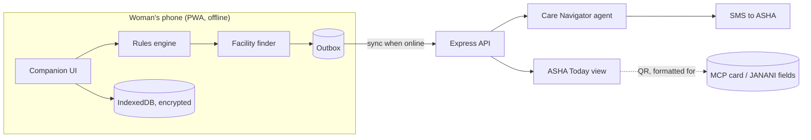

# 🌸 Vatsala

**Tender care through every phase, from first period to first birthday.**

Vatsala (वत्सला, *VAT-sa-laa*, Sanskrit for tender, motherly affection) is a voice-first, offline-first women's health companion for India. It flags danger signs using guideline-based rules, guides women to the right health facility, and closes the loop with their ASHA worker without adding any data entry to the ASHA's day.

Built for **K! Hacks 4.0** (CEG Tech Forum, Anna University) · Track: **Women Empowerment** · Also relevant: Health Tech, Agentic AI

> ⚠️ **Medical disclaimer:** Vatsala provides health education and guidance on when to seek care. It does not diagnose, prescribe or replace a doctor, nurse or ASHA. In an emergency, call **108**.

---

## The problem

- Women in India *reach* the health system: ANC coverage is about 96% (NFHS-6). The gap is **between visits**. When a danger sign appears at home, many women don't recognise it, don't know where to go, or can't reach anyone.
- Menstrual health and maternal health are treated as separate products, though they are one life course. More than half of women of reproductive age are anaemic (NFHS-5), and that carries into pregnancy.
- ASHA workers, who could close this loop, already juggle many apps and duplicate paper and digital entries. **Another app that adds work will fail.**

Full evidence and sources: [`docs/context.md`](docs/context.md)

## What Vatsala does

| Module | What it does |
|---|---|
| **Companion** | Life-stage modes (cycle → pre-conception → pregnancy → postpartum → baby). Voice-first, pictogram check-ins, reminders for ANC, IFA, Td, PMSMA and vaccines. Short audio lessons and a myth-buster. |
| **Danger-sign engine** | Rules from official guidance (MCP card and others) return **GREEN / AMBER / RED** on the device, offline, in milliseconds. Every result shows *which rule fired* and its source. |
| **Care Navigator agent** | On AMBER/RED: finds the nearest facility *able to handle it*, notifies the ASHA, schedules a follow-up ("Did you reach?"), explains in plain language, checks scheme entitlements, and routes hard questions to a human expert. |
| **ASHA Today view** | One auto-ranked list (urgent flags → follow-ups → missed visits → postnatal visit days). One-tap actions, a daily SMS digest, and QR scan to link records. **No forms.** |
| **Privacy & discreet mode** | Encrypted on-device storage, PIN, a disguised app mode for shared phones, per-category sharing consent. No ads, no third-party analytics. |

### Safety design
- Triage is **deterministic and rule-based**, not a machine-learning score.
- The LLM **can never lower** a triage level. It only explains, routes and writes messages.
- RED always errs toward "go now". Over-referral is acceptable; under-referral is not.
- Every rule in `packages/rules/rules.json` carries a `source` field and a reviewer field.
- If the AI service is down, template messages are sent instead.

## Architecture



The phone can produce a RED result, show the right facility and queue the ASHA alert **with no internet**. The server adds the agent's message, SMS delivery, follow-ups and the ASHA dashboard.

## Tech stack

| Layer | Choice |
|---|---|
| Frontend | React + Vite, installable PWA, Tailwind CSS |
| Offline | Service worker (vite-plugin-pwa), Dexie (IndexedDB), outbox sync |
| Safety logic | Shared JS rules engine + `rules.json` |
| Voice | Pre-recorded audio for critical messages + Web Speech API |
| Languages | i18next: English, Hindi, Tamil |
| Maps | Leaflet + OpenStreetMap online; bundled facility JSON offline |
| Backend | Node.js + Express, SQLite |
| AI | Groq LLM with tool calling, grounded on curated health documents |
| Messaging | SMS gateway / Twilio sandbox (demo) |
| QR | qrcode, html5-qrcode |

## Project structure

```
vatsala/
├── apps/
│   ├── companion/        # Woman-facing PWA
│   └── asha/             # ASHA Today view
├── packages/
│   ├── rules/            # rules.json, engine, tests
│   └── schedules/        # ANC, PNC/HBNC, UIP vaccine schedules
├── server/               # API, agent, SQLite, facilities data
└── docs/                 # idea.md, context.md, IMPLEMENTATION_PLAN.md
```

## Getting started

> These commands describe the intended setup. They'll work once the finale build is in place.

**Prerequisites:** Node.js 18+, a Groq API key (optional; the app works without it), SMS sandbox credentials (optional).

```bash
git clone https://github.com/<your-org>/vatsala.git
cd vatsala
npm install

cp server/.env.example server/.env   # add GROQ_API_KEY, SMS credentials
npm run seed                          # demo users, facilities, schedules
npm run dev                           # starts companion, ASHA view and API
```

| App | URL |
|---|---|
| Companion | http://localhost:5173 |
| ASHA view | http://localhost:5174 |
| API | http://localhost:5001 |

Run the rule tests:
```bash
npm run test:rules
```

### Try the demo flow
1. Open the Companion as **Sunita** (34 weeks pregnant) and switch on **airplane mode**.
2. Check in with *headache* + *blurred vision*. You get RED with the reason shown, the nearest FRU, and a Call 108 button.
3. Turn the network back on. The queued alert syncs and the ASHA receives an SMS.
4. Open the **ASHA view**: Sunita is at the top. Tap *Called* and watch the follow-up timer.

## Privacy

- Health data stays **on the device** by default, encrypted with a PIN-derived key.
- Sharing with the ASHA is **opt-in and per category** (pregnancy, cycle, mental health).
- Notifications never show sensitive text on the lock screen.
- No ad SDKs, no third-party analytics, no data sale.
- Designed with India's DPDP Act 2023 and DPDP Rules 2025 in mind, including verifiable parental consent for users under 18. **Legal review is required before any real-world deployment.**

## Roadmap

- [ ] Clinical review of all rules by an OBG / community medicine expert
- [ ] Pilot: 1 PHC, 10 ASHAs, 200 women, 3 months
- [ ] IVR / feature-phone channel
- [ ] Interoperability with ABHA and JANANI through official channels
- [ ] On-device LLM for offline Q&A in more languages
- [ ] Newborn danger-sign module

## Prior work disclosure

Vatsala builds on our earlier open-source project **[Eunoia v2](https://github.com/neevmodh/eunoia)**, an adolescent menstrual health and wellness platform. The K! Hacks 4.0 finale code in this repository is a **new codebase**, written during the hackathon. Only non-code assets (education content, rule definitions, translations, audio, facility data) were prepared in advance, as disclosed to the organisers.

## Team

| Name | Role | College |
|---|---|---|
| _Name_ | Lead / Agent | _College_ |
| _Name_ | Companion frontend | _College_ |
| _Name_ | ASHA view / Offline | _College_ |
| _Name_ | Backend / Data / Pitch | _College_ |

## Emergency & support numbers

| Service | Number |
|---|---|
| Ambulance / medical emergency | 108 |
| Tele-MANAS (mental health) | 14416 |

*Verify all numbers before deployment or demo.*

## License

MIT. See [`LICENSE`](LICENSE).

---

*Built with care for every girl and woman who deserves to know when her body needs help, and where to find it.*
